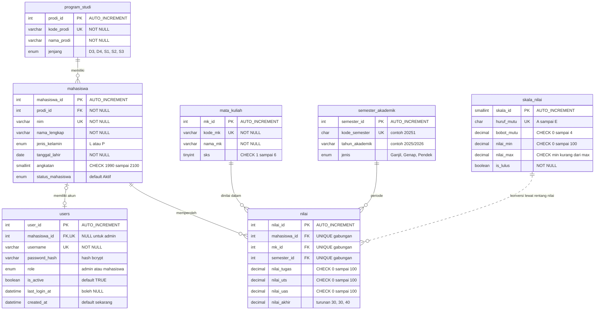

# Academic Management System (SIAKAD): Nilai & IPK

Aplikasi desktop berbasis Python (GUI) dan MySQL untuk mengelola nilai mahasiswa dan menghitung IPS/IPK. Pengguna wajib login. Dibuat sebagai proyek UAS mata kuliah Basis Data.

## Fitur

- Login wajib dengan dua role: **admin** dan **mahasiswa**
- Manajemen data mahasiswa, program studi, mata kuliah, dan semester (admin)
- Pembuatan dan pengelolaan akun mahasiswa oleh admin
- Input nilai (tugas, UTS, UAS); nilai akhir dihitung otomatis oleh database
- Konversi nilai angka ke huruf mutu melalui skala nilai yang dapat diubah
- Perhitungan **IPS** per semester dan **IPK** menggunakan VIEW
- Transkrip nilai beserta status kelulusan
- Pencarian dan filter data
- Validasi data lewat constraint dan trigger

Bobot nilai akhir yang dipakai: tugas 30%, UTS 30%, UAS 40%. Untuk mata kuliah yang diulang, IPK memakai nilai terbaik.

## Hak Akses

| Fitur                                             | Admin           | Mahasiswa              |
| ------------------------------------------------- | --------------- | ---------------------- |
| Kelola mahasiswa dan akun                         | ya              | tidak                  |
| Kelola data master (prodi, semester, mata kuliah) | ya              | tidak                  |
| Input nilai                                       | ya              | tidak                  |
| Lihat transkrip dan IPK                           | semua mahasiswa | hanya miliknya sendiri |

## Desain Database

Database `siakad` terdiri dari 7 tabel dan dinormalisasi hingga **3NF**.

| Tabel               | Fungsi                                                      |
| ------------------- | ----------------------------------------------------------- |
| `program_studi`     | Data program studi                                          |
| `mahasiswa`         | Biodata inti mahasiswa (NIM, nama, prodi, angkatan, status) |
| `users`             | Akun login (admin atau mahasiswa)                           |
| `mata_kuliah`       | Kode, nama, dan SKS                                         |
| `semester_akademik` | Daftar semester                                             |
| `skala_nilai`       | Huruf mutu, bobot mutu, dan rentang nilai                   |
| `nilai`             | Nilai per mahasiswa, mata kuliah, dan semester              |

### ERD

Keterangan: `PK` primary key, `FK` foreign key, `UK` unique. Teks dalam tanda kutip adalah constraint atau aturan pada kolom tersebut.



Cara membaca relasi: `||` tepat satu, `o|` nol atau satu, `o{` nol atau banyak. Garis putus-putus berarti relasi logis tanpa foreign key. Versi gambar tersedia di [docs/erd_ipk.png](docs/erd_ipk.png).

### Aturan dan constraint

| Aturan                                                                | Cara penerapan                                           |
| --------------------------------------------------------------------- | -------------------------------------------------------- |
| Satu mahasiswa hanya punya satu nilai per mata kuliah per semester    | `UNIQUE (mahasiswa_id, mk_id, semester_id)` pada `nilai` |
| Nilai tugas, UTS, UAS harus 0 sampai 100                              | `CHECK` pada `nilai`                                     |
| Nilai akhir selalu konsisten dengan komponennya                       | _generated column_: tugas 30% + UTS 30% + UAS 40%        |
| Admin tidak punya profil mahasiswa, akun mahasiswa wajib punya        | `CHECK` pada `users`                                     |
| NIM, username, kode mata kuliah, dan kode semester tidak boleh kembar | `UNIQUE`                                                 |
| SKS antara 1 dan 6                                                    | `CHECK` pada `mata_kuliah`                               |
| Nilai baru hanya untuk mahasiswa berstatus Aktif                      | trigger `trg_nilai_cek_status_bi`                        |
| IPS, IPK, dan transkrip dihitung tanpa menyimpan data ganda           | `VIEW`: `v_ips`, `v_ipk`, `v_transkrip`                  |

### Catatan desain

- `nilai_akhir` adalah kolom turunan yang dihitung database dari nilai tugas, UTS, dan UAS.
- Huruf mutu **tidak** disimpan di tabel `nilai`, karena akan menimbulkan ketergantungan transitif (`nilai_akhir` menentukan huruf mutu). Huruf mutu diperoleh saat query dengan mencocokkan `nilai_akhir` ke rentang di `skala_nilai`.
- IPS dan IPK dihitung melalui VIEW, tidak disimpan sebagai data tersendiri.

## Struktur Proyek

```
AcademicManagementSystem/
├── main.py
├── config.py
├── requirements.txt
├── .env.example
│
├── database/
│   ├── connection.py
│   ├── schema.sql
│   ├── seed.sql
│   ├── triggers_views.sql
│   └── create_admin.py
│
├── backend/                 # logika bisnis dan query ke database
│   ├── auth.py
│   ├── user.py
│   ├── prodi.py
│   ├── mahasiswa.py
│   ├── mata_kuliah.py
│   ├── semester.py
│   ├── nilai.py
│   └── ipk.py
│
├── frontend/                # tampilan GUI
│   ├── main_window.py
│   ├── login_page.py
│   ├── mahasiswa_page.py
│   ├── akademik_master_page.py
│   ├── nilai_page.py
│   └── transkrip_page.py
│
├── utils/
│   ├── validators.py
│   ├── security.py
│   ├── session.py
│   └── permissions.py
│
├── docs/
│   └── erd_ipk.png
│
└── assets/
```

Lapisan `frontend/` tidak berisi SQL. Semua akses database dilakukan lewat `backend/`.

## Teknologi

- Python 3.10+ dengan CustomTkinter untuk GUI
- MySQL 8.0.16+ (diperlukan agar `CHECK` constraint ditegakkan)
- Library lain: lihat `requirements.txt`
- Disarankan memakai Laragon (menyediakan MySQL, HeidiSQL, dan phpMyAdmin)

## Instalasi

1. **Clone repository**

   ```bash
   git clone https://github.com/rhalstlyapp/AcademicManagementSystem.git
   cd AcademicManagementSystem
   ```

2. **Buat virtual environment dan install dependensi**

   ```bash
   python -m venv venv
   venv\Scripts\activate          # Windows
   source venv/bin/activate       # macOS / Linux
   pip install -r requirements.txt
   ```

3. **Siapkan database**

   Pastikan MySQL sudah berjalan, lalu import berurutan (jalankan di Command Prompt):

   ```bash
   mysql -u root < database\schema.sql
   mysql -u root < database\seed.sql
   mysql -u root < database\triggers_views.sql
   ```

   Perhatian: `schema.sql` menjalankan `DROP DATABASE siakad` sehingga database lama dibangun ulang dari nol.

   Operator `<` tidak didukung di PowerShell. Gunakan Command Prompt, atau perintah `source` di dalam prompt `mysql>`, atau fitur **Import** di phpMyAdmin / **Run SQL file** di HeidiSQL. Tambahkan `-p` setelah `-u root` jika MySQL kamu memakai password.

4. **Konfigurasi environment**

   ```bash
   copy .env.example .env         # Windows
   cp .env.example .env           # macOS / Linux
   ```

   Isi `DB_USER`, `DB_PASSWORD`, dan nilai lainnya di file `.env`. Pada Laragon bawaan, `DB_USER=root` dan `DB_PASSWORD` dibiarkan kosong.

5. **Buat akun admin pertama**

   ```bash
   python database/create_admin.py
   ```

   Password diketik saat skrip berjalan dan tidak tampil di layar. Akun mahasiswa dibuat oleh admin melalui aplikasi.

6. **Jalankan aplikasi**

   ```bash
   python main.py
   ```

## Alur Pengembangan

- Branch utama: `main`
- Satu branch per fitur, misalnya `feature/nilai` atau `feature/ipk`
- Pesan commit: `feat: ...`, `fix: ...`, `docs: ...`, `refactor: ...`

## Status

Dalam pengembangan.
