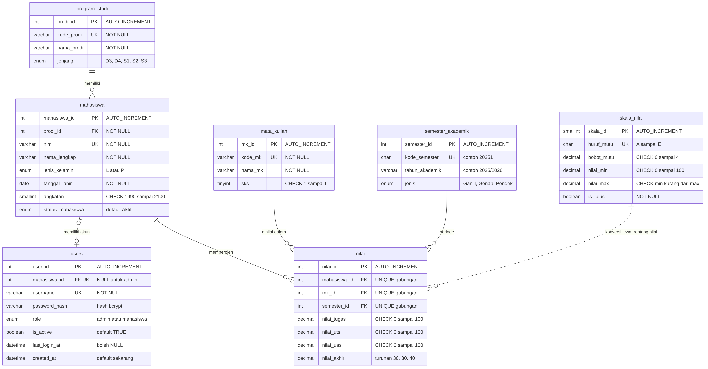

# Academic Management System (SIAKAD): Nilai & IPK

Aplikasi berbasis Python dan MySQL untuk mengelola nilai mahasiswa dan menghitung IPS/IPK. Dibuat sebagai proyek UAS mata kuliah Basis Data.

## Fitur

- Manajemen data mahasiswa, program studi, mata kuliah, dan semester
- Input nilai (tugas, UTS, UAS) dengan nilai akhir yang dihitung otomatis oleh database
- Konversi nilai angka ke huruf mutu melalui skala nilai yang dapat diubah
- Perhitungan **IPS** per semester dan **IPK** menggunakan VIEW
- Transkrip nilai mahasiswa
- Pencarian dan filter data
- Validasi data (nilai 0-100, NIM unik, SKS 1-6, satu nilai per mahasiswa/mata kuliah/semester)

Bobot nilai akhir yang dipakai saat ini: tugas 30%, UTS 30%, UAS 40% (dapat disesuaikan).

## Desain Database

Database `siakad` terdiri dari 6 tabel dan dinormalisasi hingga **3NF**.

| Tabel               | Fungsi                                                      |
| ------------------- | ----------------------------------------------------------- |
| `program_studi`     | Data program studi                                          |
| `mahasiswa`         | Biodata inti mahasiswa (NIM, nama, prodi, angkatan, status) |
| `mata_kuliah`       | Kode, nama, dan SKS                                         |
| `semester_akademik` | Daftar semester                                             |
| `skala_nilai`       | Huruf mutu, bobot mutu, dan rentang nilai                   |
| `nilai`             | Nilai per mahasiswa, mata kuliah, dan semester              |

Catatan desain:

- `nilai_akhir` adalah kolom turunan yang dihitung database dari nilai tugas, UTS, dan UAS.
- Huruf mutu **tidak** disimpan di tabel `nilai`, karena akan menimbulkan ketergantungan transitif (`nilai_akhir` menentukan huruf mutu). Huruf mutu diperoleh saat query dengan mencocokkan `nilai_akhir` ke rentang di `skala_nilai`.
- IPS dan IPK dihitung melalui VIEW (`v_ips`, `v_ipk`, `v_transkrip`), tidak disimpan sebagai data tersendiri.



## Struktur Proyek

```
AcademicManagementSystem/
├── main.py
├── config.py
├── requirements.txt
├── .env.example
│
├── database/
│   ├── connection.py
│   ├── schema.sql
│   ├── seed.sql
│   └── triggers_views.sql
│
├── backend/                 # logika bisnis dan query ke database
│   ├── prodi.py
│   ├── mahasiswa.py
│   ├── mata_kuliah.py
│   ├── semester.py
│   ├── nilai.py
│   └── ipk.py
│
├── frontend/                # tampilan GUI
│   ├── mahasiswa_page.py
│   ├── akademik_master_page.py
│   ├── nilai_page.py
│   └── transkrip_page.py
│
├── utils/
│   └── validators.py
│
├── docs/
│   └── erd_ipk.png
│
└── assets/
```

Lapisan `frontend/` tidak berisi SQL. Semua akses database dilakukan lewat `backend/`.

## Teknologi

- Python 3.10+
- MySQL 8.0.16+ (diperlukan agar `CHECK` constraint ditegakkan)
- Library: lihat `requirements.txt`
- Disarankan memakai Laragon (menyediakan MySQL, HeidiSQL, dan phpMyAdmin)

## Instalasi

1. **Clone repository**

   ```bash
   git clone https://github.com/rhalstlyapp/AcademicManagementSystem.git
   cd AcademicManagementSystem
   ```

2. **Buat virtual environment dan install dependensi**

   ```bash
   python -m venv venv
   venv\Scripts\activate          # Windows
   source venv/bin/activate       # macOS / Linux
   pip install -r requirements.txt
   ```

3. **Siapkan database**

   Pastikan MySQL sudah berjalan, lalu import berurutan (jalankan di Command Prompt):

   ```bash
   mysql -u root < database\schema.sql
   mysql -u root < database\seed.sql
   mysql -u root < database\triggers_views.sql
   ```

   Catatan: operator `<` tidak didukung di PowerShell. Gunakan Command Prompt, atau perintah `source` di dalam prompt `mysql>`, atau fitur **Import** di phpMyAdmin / **Run SQL file** di HeidiSQL. Tambahkan `-p` setelah `-u root` jika MySQL kamu memakai password.

4. **Konfigurasi environment**

   ```bash
   copy .env.example .env         # Windows
   cp .env.example .env           # macOS / Linux
   ```

   Isi `DB_USER`, `DB_PASSWORD`, dan nilai lainnya di file `.env`. Pada Laragon bawaan, `DB_USER=root` dan `DB_PASSWORD` dibiarkan kosong.

5. **Jalankan aplikasi**

   ```bash
   python main.py
   ```

## Alur Pengembangan

- Branch utama: `main`
- Satu branch per fitur, misalnya `feature/nilai` atau `feature/ipk`
- Pesan commit: `feat: ...`, `fix: ...`, `docs: ...`, `refactor: ...`

## Status

Dalam pengembangan.
