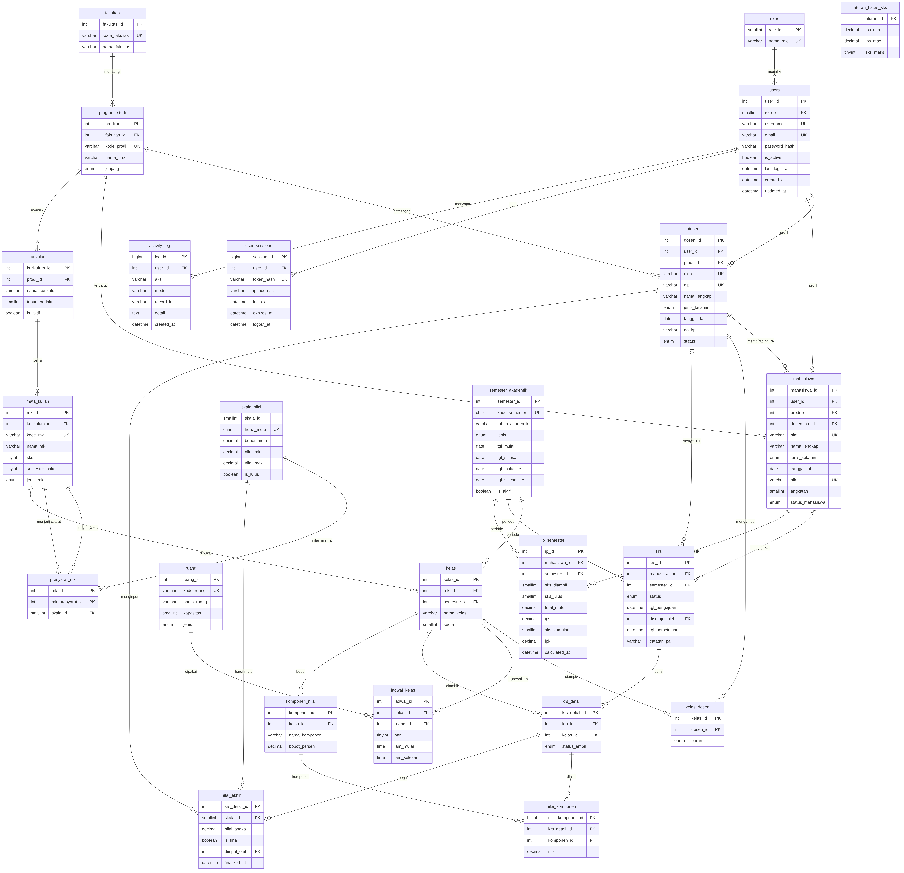

# Academic Management System (SIAKAD)

Sistem Informasi Akademik perguruan tinggi berbasis Python dan MySQL, dengan akses berbasis peran (Admin, Dosen, Mahasiswa).

## Fitur

- **Login & manajemen akun**: role-based access, akun aktif/nonaktif, pencatatan sesi dan aktivitas
- **Dashboard**: ringkasan statistik akademik
- **Data master**: fakultas, program studi, semester akademik, ruang, kurikulum
- **Mahasiswa & Dosen**: biodata, program studi/homebase, Dosen Wali (PA)
- **Mata kuliah**: kode, SKS, semester, prasyarat
- **Perkuliahan**: kelas, dosen pengampu, jadwal, ruang
- **KRS**: pengisian per semester dan persetujuan Dosen PA
- **Nilai**: komponen (tugas, UTS, UAS), nilai akhir, huruf mutu
- **IPS/IPK & Transkrip**: dihitung dari bobot SKS dan nilai mutu
- **Validasi**: batas SKS berdasarkan IPS, jadwal bentrok, prasyarat, kuota kelas

## Struktur Proyek

```
AcademicManagementSystem/
├── main.py              # entry point aplikasi
├── config.py            # membaca konfigurasi dari .env
├── database/            # koneksi dan skrip SQL
├── backend/             # logika bisnis (satu-satunya lapisan yang mengakses DB)
├── frontend/            # tampilan GUI
├── utils/               # session, permission, validator, security
├── docs/                # dokumentasi dan ERD
└── assets/              # logo dan ikon
```

## ERD



Rancangan database dinormalisasi hingga **3NF**.

## Teknologi

- Python 3.10+
- MySQL 8
- Library: lihat `requirements.txt`

## Instalasi

1. **Clone repository**
   ```bash
   git clone https://github.com/<username>/AcademicManagementSystem.git
   cd AcademicManagementSystem
   ```

2. **Buat virtual environment dan install dependensi**
   ```bash
   python -m venv venv
   venv\Scripts\activate          # Windows
   source venv/bin/activate       # macOS / Linux
   pip install -r requirements.txt
   ```

3. **Siapkan database**
   ```sql
   CREATE DATABASE siakad CHARACTER SET utf8mb4 COLLATE utf8mb4_unicode_ci;
   ```
   Lalu import berurutan:
   ```bash
   mysql -u <user> -p siakad < database/schema.sql
   mysql -u <user> -p siakad < database/seed.sql
   mysql -u <user> -p siakad < database/triggers_views.sql
   ```

4. **Konfigurasi environment**
   ```bash
   copy .env.example .env         # Windows
   cp .env.example .env           # macOS / Linux
   ```
   Isi `DB_USER`, `DB_PASSWORD`, dan nilai lainnya di file `.env`.

5. **Jalankan aplikasi**
   ```bash
   python main.py
   ```

## Akun Awal

Akun admin awal dibuat oleh `database/seed.sql`. Ganti password default segera setelah login pertama.

## Alur Pengembangan

- Branch utama: `main`
- Satu branch per fitur: `feature/krs`, `feature/nilai`, dst.
- Pesan commit: `feat: ...`, `fix: ...`, `docs: ...`, `refactor: ...`

## Status

Dalam pengembangan.
